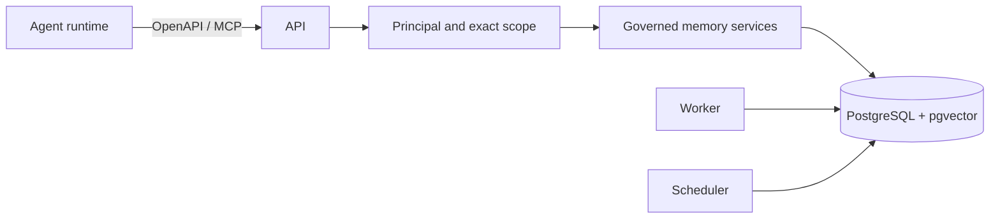

# Stele

Stele is a Go-based, self-hosted agent memory service. It gives an external
agent runtime governed durable memory, exact-scope retrieval, bounded context,
and operational evidence without owning the agent, model calls, prompts, SDK,
or user interface.

PostgreSQL is the only system of record. pgvector supports semantic retrieval,
PostgreSQL full-text search supports lexical retrieval, and memory remains
versioned, attributable, lifecycle-governed, and isolated by tenant, project,
and namespace.

## What Stele provides

- Governed event ingestion and memory intents.
- Canonical memory versions, provenance, lifecycle, and forgetting controls.
- Lexical, semantic, hybrid, and context-oriented retrieval with citations.
- Three deployable runtime modes: API, worker, and scheduler.
- Optional OpenAPI-backed provider and MCP adapters.
- PostgreSQL-backed operational history, conformance, assurance, and recovery
  evidence.

## Architecture at a glance



| Runtime mode | Purpose |
| --- | --- |
| `api` | Request handling, authentication, ingest, retrieval, context, admin, provider, and optional MCP routes |
| `worker` | Lease-aware asynchronous governance, consolidation, lifecycle, and derived work |
| `scheduler` | Periodic retention, compaction, embedding rebuild, cleanup, and assurance dispatch |

Read [Architecture](docs/architecture.md) for request flow and system
boundaries, and [Key components](docs/components.md) for repository ownership
and extension points.

## Quick start

Run the self-hosted stack:

```powershell
Copy-Item .env.local.example .env.local
# Replace placeholders in .env.local before starting the stack.
docker compose --env-file .env.local up --build -d
```

Verify baseline dependency readiness:

```powershell
curl http://localhost:8080/health
curl http://localhost:8080/ready
```

`/ready` confirms baseline dependency readiness only. On a fresh database, use
the bootstrap-admin key from `.env.local` to create a durable admin and an
exact-scope runtime principal before calling protected memory APIs.

Follow the complete bootstrap, migration, embedding, backup, restore, and smoke
instructions in [Self-hosting](docs/self-hosting.md).

## Documentation

Start with the [documentation portal](docs/README.md). It provides the
recommended path for understanding, running, integrating, and maintaining
Stele.

## Choose an integration boundary

| You need to... | Start with | Do not use it for |
| --- | --- | --- |
| Give a public agent runtime governed context or writes | [Provider runtime](docs/agent-runtime-memory-provider.md) | administrator MCP or native-read fallback |
| Let an administrator inspect or review memory | [MCP integration](docs/integrations/mcp-agent-skill.md) | public agent credentials |
| Build a custom service client | [OpenAPI](openapi/spec.go) | bypassing principal and scope rules |
| Operate a deployment | [Self-hosting](docs/self-hosting.md) | application business-state management |

## Agent access: Provider runtime and administrator MCP

Public agent credentials use the [Provider contract](docs/agent-runtime-memory-provider.md).
Provision an explicit exact-scope disclosure profile, discover capabilities,
initialize a runtime binding, then request `/v1/provider/context`. The default
`reference_only` mode returns structured references. `bounded_content` requires
the `memory-content-v1` profile and an explicit mode request. Public credentials
can use the disclosure-projected Provider retrieve and server-issued turn
routes, but cannot use native retrieval or MCP tools, including `who_am_i`.
PostgreSQL-backed runtime initialization also ensures the exact-scope session
record exists, so the first Provider turn does not require a separate native
session-creation call.

Durable task/run/handoff/compilation references, context budgeting and digest /
continuity, and runtime outcome/feedback each use separately negotiated,
versioned Provider capabilities. Session/turn correlation can require the
`context-turn-binding-v1` capability; the optional turn identifier is verified
against the full runtime binding and exact scope and does not widen retrieval or
disclosure. See the [Provider reference](docs/agent-runtime-memory-provider.md)
for request shapes, byte units, limits, errors, migration and rollback, and
[projection maintenance](docs/provider-evidence-projections.md) for feedback
behavior. Byte limits are not token estimates; client token budgeting remains
the integrating application's responsibility.

Read the [disclosure and source trust guide](docs/context-disclosure-and-source-trust.md)
for profile administration, source labels, endpoint denials and migration.

MCP is optional and disabled by default. Enable it in `.env.local` after the
base stack is healthy:

```dotenv
STELE_MCP_ENABLED=true
STELE_MCP_PATH=/mcp
```

For administrator-operated memory workflows, restart the API runtime and
configure your MCP client to call `/mcp` with a durable administrator credential
and an explicitly authorized exact scope. Start the operator workflow with:

```text
who_am_i -> memory_context or memory_search -> answer with citations
```

Use `memory_remember` for governed durable writes with a reason and idempotency
key. For semantic forgetting, use `memory_forget_preview` first and then apply
only reviewed IDs with `memory_forget_apply`.

The complete setup, current request shapes, tool annotations, limits, and error
handling are in the [MCP integration guide](docs/integrations/mcp-agent-skill.md).

### Agent Skill

The portable, repository-provided Agent Skill is
[skills/stele-memory/SKILL.md](skills/stele-memory/SKILL.md). Copy it into your
agent host's skill directory or include it as repository context. It teaches
Provider provisioning and mode validation, conservative source treatment,
administrator MCP workflows, citations and bounded error handling.

## MCP tool matrix

These tools require administrator access under the current disclosure contract.
The public runtime uses Provider operations instead.

| Tool | Use | Safety class |
| --- | --- | --- |
| `who_am_i` | Resolve identity, scope, and binding | read-only, idempotent |
| `memory_search` | Search governed evidence | read-only, idempotent |
| `memory_context` | Assemble bounded context | read-only, idempotent |
| `memory_browse` | Review visible memory | read-only, idempotent |
| `memory_remember` | Submit governed memory intent | idempotent write |
| `memory_forget_preview` | Review semantic forget candidates | read-only, idempotent |
| `memory_forget_apply` | Apply reviewed candidate IDs | destructive, idempotent |
| `memory_forget` | Act on one known memory ID | destructive, idempotent |

## Documentation paths

- **Understand:** [Architecture](docs/architecture.md), [components](docs/components.md), and [best practices](docs/best-practices.md).
- **Run:** [Getting started](docs/getting-started.md) and [self-hosting](docs/self-hosting.md).
- **Integrate:** [Provider](docs/agent-runtime-memory-provider.md), [MCP](docs/integrations/mcp-agent-skill.md), [memory repository import](docs/integrations/memory-repository-import.md), and the [OpenAPI source](openapi/spec.go).
- **Extend and maintain:** [Agent Skill](skills/stele-memory/SKILL.md), [MCP conformance](scripts/stele-mcp-conformance.ps1), and [OpenSpec changes](openspec/changes).

## Operating principles

- Resolve and retain exact scope before every memory operation.
- Keep PostgreSQL as the only system of record.
- Do not overwrite canonical memory in place; use governed events, intents,
  versions, and lifecycle actions.
- Keep reads lifecycle-safe and citations bounded.
- Use stable idempotency keys for governed writes and destructive operations.
- Treat MCP as an adapter over service contracts, never as direct database
  access.

See [Best practices](docs/best-practices.md) for practical workflows and
recovery guidance.

Strict Provider consumers that need session/turn proof may require the
`context-turn-binding-v1` capability, create a Provider turn, and send its
optional `turn_id` with context. Stele verifies the same full runtime binding,
session, and exact scope before retrieval, echoes only the verified ID, and
binds it into a versioned turn digest/fingerprint. Foreign or legacy-unbound
turns are denied without existence disclosure; the field never widens memory
selection or disclosure and provides no role, token, snapshot, or business
state authority.

## Contributing documentation and MCP guidance

When changing an MCP tool, its descriptor, annotation, request shape, or safety
boundary, update all of these in the same OpenSpec change:

1. `internal/mcp/schema.go` and relevant contract tests.
2. [MCP integration guide](docs/integrations/mcp-agent-skill.md).
3. [Agent Skill](skills/stele-memory/SKILL.md).
4. This README tool matrix when the public tool set changes.

Before review, run the documentation check, MCP tests, and strict OpenSpec
validation described in the integration guide. Use `openspec propose`,
`openspec apply`, and `openspec validate --all --strict` for planned work.

## Context disclosure and source trust

Public runtime credentials require explicit exact-scope disclosure provisioning.
Provider context defaults to structured references; bounded content requires the
content profile and explicit mode. Unsupported native/MCP data routes deny public
credentials before lookup. Source labels persist through governance and history;
missing lineage is untrusted/restricted. Attested source data grants no instruction,
tool, write or business-state authority. See the [disclosure/source guide](docs/context-disclosure-and-source-trust.md)
for endpoint behavior, administration, versioning and upgrade/rollback.
