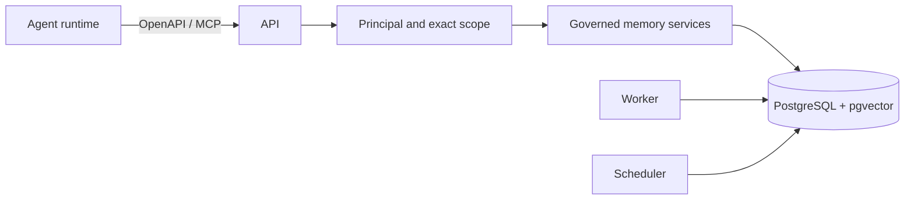

# Stele

Stele is a Go-based, self-hosted agent memory service. It gives an external
agent runtime governed durable memory, exact-scope retrieval, bounded context,
and operational evidence without owning the agent, model calls, prompts, SDK,
or user interface.

PostgreSQL is the only system of record. pgvector supports semantic retrieval,
PostgreSQL full-text search supports lexical retrieval, and memory remains
versioned, attributable, lifecycle-governed, and isolated by tenant, project,
and namespace.

## What Stele provides

- Governed event ingestion and memory intents.
- Canonical memory versions, provenance, lifecycle, and forgetting controls.
- Lexical, semantic, hybrid, and context-oriented retrieval with citations.
- Three deployable runtime modes: API, worker, and scheduler.
- Optional OpenAPI-backed provider and MCP adapters.
- PostgreSQL-backed operational history, conformance, assurance, and recovery
  evidence.

## Architecture at a glance



| Runtime mode | Purpose |
| --- | --- |
| `api` | Request handling, authentication, ingest, retrieval, context, admin, provider, and optional MCP routes |
| `worker` | Lease-aware asynchronous governance, consolidation, lifecycle, and derived work |
| `scheduler` | Periodic retention, compaction, embedding rebuild, cleanup, and assurance dispatch |

Read [Architecture](docs/architecture.md) for request flow and system
boundaries, and [Key components](docs/components.md) for repository ownership
and extension points.

## Quick start

Run the self-hosted stack:

```powershell
Copy-Item .env.local.example .env.local
# Replace placeholders in .env.local before starting the stack.
docker compose --env-file .env.local up --build -d
```

Verify baseline dependency readiness:

```powershell
curl http://localhost:8080/health
curl http://localhost:8080/ready
```

`/ready` confirms baseline dependency readiness only. On a fresh database, use
the bootstrap-admin key from `.env.local` to create a durable admin and an
exact-scope runtime principal before calling protected memory APIs.

Follow the complete bootstrap, migration, embedding, backup, restore, and smoke
instructions in [Self-hosting](docs/self-hosting.md).

## Agent access: Provider runtime and administrator MCP

Public agent credentials use the [Provider contract](docs/agent-runtime-memory-provider.md).
Provision an explicit exact-scope disclosure profile, discover capabilities,
initialize a runtime binding, then request `/v1/provider/context`. The default
`reference_only` mode returns structured references. `bounded_content` requires
the `memory-content-v1` profile and an explicit mode request. Public credentials
cannot use native retrieval or MCP tools, including `who_am_i`.

Durable task/run/handoff/compilation references use the separately negotiated
PC5 contract described in the [Provider reference section](docs/agent-runtime-memory-provider.md#durable-reference-contract-pc5).

Discover `context_budget_version=context-budget-v1`,
`context_packing_policy_version=context-packing-v1`, and
`token_budget_supported=false` alongside the disclosure/source versions. Required
`input.budget` counts item placements; optional `budget_limits` allocates UTF-8
content bytes, complete serialized response bytes and unique citations. Omitted
limits use independently published server ceilings; zero content/citations is
valid. Defaults are 100 items, 100 citations, 1 MiB response bytes and content
bytes inherited from the resolved response ceiling. Every successful response
includes closed `result.budget_accounting` with requested/effective limits, exact
usage and safe selection reasons. Whole items and their citations share one
allocation; deterministic accounting reservation can leave unused space.

Consumers reserve other prompt space, validate actual body length and all usage
against effective limits, and treat missing/incompatible accounting as a contract
failure. Bytes are never token estimates, and optional public insights/goals/raw
diagnostics remain closed. An infeasible empty envelope returns bounded 413 with
no partial result; malformed limits use 400, current disclosure denial 403 and
unavailable authority retryable 503. Strict consumers must migrate schemas and
discover the extension explicitly; disable affected access before rolling back
to a service that lacks it. The [Provider guide](docs/agent-runtime-memory-provider.md)
covers units, ordering, errors and migration, and [self-hosting](docs/self-hosting.md)
covers independent configuration. Historical PC1/PC2 evidence does not prove PC3
readiness or PC4 digest/continuity readiness.

Provider context also returns a mandatory versioned SHA-256 digest of the final
authorized projection and a continuity result. Omit continuity for a fresh
read; request `{"mode":"issue"}` to receive an expiring opaque metadata-only
comparison reference; send `{"mode":"compare","reference":"ctxc_<32 lowercase hex>"}`
for a later full fresh body marked `unchanged` or `changed`. This is not HTTP
cache validation: Stele never returns 304, a historical body, a snapshot replay
or a watermark. Receipts persist only identity/fingerprint/digest/timestamps,
never queries, content, citations or response bodies. Consumers verify
`context-digest-v1`, `context-canonical-v1`, `context-selection-v1` and
`context-continuity-v1`, recompute the digest from the exact captured body, and
stop on 409 continuity refusals or retryable 503 rather than locally ranking,
packing or reconstructing context. [Provider contract details and byte vectors](docs/agent-runtime-memory-provider.md#projection-digest-and-fresh-continuity)
and [self-hosting settings](docs/self-hosting.md#provider-context-continuity-configuration)
describe rollout, bounds and rollback.

Read the [disclosure and source trust guide](docs/context-disclosure-and-source-trust.md)
for profile administration, source labels, endpoint denials and migration.

MCP is optional and disabled by default. Enable it in `.env.local` after the
base stack is healthy:

```dotenv
STELE_MCP_ENABLED=true
STELE_MCP_PATH=/mcp
```

For administrator-operated memory workflows, restart the API runtime and
configure your MCP client to call `/mcp` with a durable administrator credential
and an explicitly authorized exact scope. Start the operator workflow with:

```text
who_am_i -> memory_context or memory_search -> answer with citations
```

Use `memory_remember` for governed durable writes with a reason and idempotency
key. For semantic forgetting, use `memory_forget_preview` first and then apply
only reviewed IDs with `memory_forget_apply`.

The complete setup, current request shapes, tool annotations, limits, and error
handling are in the [MCP integration guide](docs/integrations/mcp-agent-skill.md).

### Agent Skill

The portable, repository-provided Agent Skill is
[skills/stele-memory/SKILL.md](skills/stele-memory/SKILL.md). Copy it into your
agent host's skill directory or include it as repository context. It teaches
Provider provisioning and mode validation, conservative source treatment,
administrator MCP workflows, citations and bounded error handling.

## MCP tool matrix

These tools require administrator access under the current disclosure contract.
The public runtime uses Provider operations instead.

| Tool | Use | Safety class |
| --- | --- | --- |
| `who_am_i` | Resolve identity, scope, and binding | read-only, idempotent |
| `memory_search` | Search governed evidence | read-only, idempotent |
| `memory_context` | Assemble bounded context | read-only, idempotent |
| `memory_browse` | Review visible memory | read-only, idempotent |
| `memory_remember` | Submit governed memory intent | idempotent write |
| `memory_forget_preview` | Review semantic forget candidates | read-only, idempotent |
| `memory_forget_apply` | Apply reviewed candidate IDs | destructive, idempotent |
| `memory_forget` | Act on one known memory ID | destructive, idempotent |

## Documentation map

| Reader need | Start here |
| --- | --- |
| Understand system boundaries and data flow | [Architecture](docs/architecture.md) |
| Locate package responsibilities and extension points | [Key components](docs/components.md) |
| Integrate an agent through MCP | [MCP integration and Agent Skill](docs/integrations/mcp-agent-skill.md) |
| Operate memory safely | [Best practices](docs/best-practices.md) |
| Deploy, migrate, back up, and verify | [Self-hosting](docs/self-hosting.md) |
| Integrate a runtime provider | [Agent runtime provider](docs/agent-runtime-memory-provider.md) |
| Migrate Provider context JSON | [Typed context contract and maintenance notes](docs/agent-runtime-memory-provider.md#provider-context-json-contract) |
| Understand public API schemas | [OpenAPI specification](openapi/spec.go) |
| Run optional MCP conformance | [`scripts/stele-mcp-conformance.ps1`](scripts/stele-mcp-conformance.ps1) |
| Review planned and archived changes | [OpenSpec configuration](openspec/config.yaml) |

## Operating principles

- Resolve and retain exact scope before every memory operation.
- Keep PostgreSQL as the only system of record.
- Do not overwrite canonical memory in place; use governed events, intents,
  versions, and lifecycle actions.
- Keep reads lifecycle-safe and citations bounded.
- Use stable idempotency keys for governed writes and destructive operations.
- Treat MCP as an adapter over service contracts, never as direct database
  access.

See [Best practices](docs/best-practices.md) for practical workflows and
recovery guidance.

## Contributing documentation and MCP guidance

When changing an MCP tool, its descriptor, annotation, request shape, or safety
boundary, update all of these in the same OpenSpec change:

1. `internal/mcp/schema.go` and relevant contract tests.
2. [MCP integration guide](docs/integrations/mcp-agent-skill.md).
3. [Agent Skill](skills/stele-memory/SKILL.md).
4. This README tool matrix when the public tool set changes.

Before review, run the documentation check, MCP tests, and strict OpenSpec
validation described in the integration guide. Use `openspec propose`,
`openspec apply`, and `openspec validate --all --strict` for planned work.

## Context disclosure and source trust

Public runtime credentials require explicit exact-scope disclosure provisioning.
Provider context defaults to structured references; bounded content requires the
content profile and explicit mode. Unsupported native/MCP data routes deny public
credentials before lookup. Source labels persist through governance and history;
missing lineage is untrusted/restricted. Attested source data grants no instruction,
tool, write or business-state authority. See the [disclosure/source guide](docs/context-disclosure-and-source-trust.md)
for endpoint behavior, administration, versioning and upgrade/rollback.
