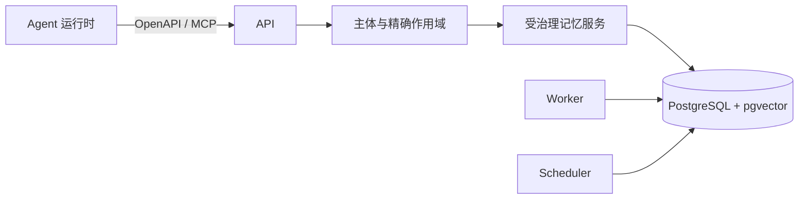

# Stele

Stele 是基于 Go、可自托管的 agent 记忆服务。它为外部 agent 运行时提供受治理的持久记忆、
精确作用域检索、有界上下文与运维证据，同时不拥有 agent、模型调用、prompt、SDK 或用户界面。

PostgreSQL 是唯一的记录系统。pgvector 支持语义检索，PostgreSQL 全文检索支持词法检索，
记忆保持版本化、可归属、受生命周期治理，并按租户、项目与命名空间隔离。

## Stele 提供什么

- 受治理的事件摄取与记忆意图。
- 规范记忆版本、来源、生命周期与遗忘控制。
- 词法、语义、混合以及面向上下文的检索，并附带引用。
- 三种可部署的运行时模式：API、worker 与 scheduler。
- 可选的、基于 OpenAPI 的 Provider 与 MCP 适配器。
- 基于 PostgreSQL 的运维历史、一致性、保障与恢复证据。
- 仅离线/仅影子的检索表示比较，保留源检索且不能改变普通检索。

## 架构一览



| 运行时模式 | 用途 |
| --- | --- |
| `api` | 请求处理、认证、摄取、检索、上下文、管理、Provider 以及可选 MCP 路由 |
| `worker` | 感知租约的异步治理、整合、生命周期与派生工作 |
| `scheduler` | 周期性保留、压缩、嵌入重建、清理与保障派发 |

请求流程与系统边界见[架构](docs/architecture.md)，仓储职责归属与扩展点见
[关键组件](docs/components.md)。

## 快速开始

运行自托管技术栈：

```powershell
Copy-Item .env.local.example .env.local
# 启动技术栈之前，替换 .env.local 中的占位符。
docker compose --env-file .env.local up --build -d
```

验证基线依赖就绪：

```powershell
curl http://localhost:8080/health
curl http://localhost:8080/ready
```

`/ready` 只确认基线依赖就绪。在全新数据库上，请使用 `.env.local` 中的 bootstrap-admin 密钥
创建持久化管理员与精确作用域的运行时主体，然后再调用受保护的记忆 API。

完整的 bootstrap、迁移、嵌入、备份、恢复与冒烟说明见[自托管](docs/self-hosting.md)。

## 文档

从[文档门户](docs/README.md)开始。它提供了理解、运行、集成与维护 Stele 的推荐路径。

## 选择集成边界

| 你需要… | 从…开始 | 不要用于 |
| --- | --- | --- |
| 为公共 agent 运行时提供受治理上下文或写入 | [Provider 运行时](docs/agent-runtime-memory-provider.md) | 管理员 MCP 或原生读取回退 |
| 让管理员检查或审阅记忆 | [MCP 集成](docs/integrations/mcp-agent-skill.md) | 公共 agent 凭据 |
| 构建自定义服务客户端 | [OpenAPI](openapi/spec.go) | 绕过主体与作用域规则 |
| 运维部署 | [自托管](docs/self-hosting.md) | 应用业务状态管理 |

## Agent 访问：Provider 运行时与管理员 MCP

公共 agent 凭据使用 [Provider 契约](docs/agent-runtime-memory-provider.md)。先配置显式的
精确作用域披露 profile，发现能力，初始化运行时绑定，然后请求 `/v1/provider/context`。
默认的 `reference_only` 模式返回结构化引用。`bounded_content` 需要 `memory-content-v1`
profile 以及显式的模式请求。公共凭据可以使用披露投影后的 Provider 检索与服务端签发的轮次
路由，但不能使用原生检索或 MCP 工具，包括 `who_am_i`。基于 PostgreSQL 的运行时初始化还会
确保精确作用域会话记录存在，因此第一次 Provider 轮次不需要单独的原生会话创建调用。

持久化的 task/run/handoff/compilation 引用、上下文预算与摘要/连续性，以及运行时结果/反馈，
各自使用独立协商、带版本的 Provider 能力。会话/轮次关联可以要求
`context-turn-binding-v1` 能力；可选的轮次标识符会针对完整运行时绑定与精确作用域进行校验，
且不会扩大检索或披露范围。请求结构、字节单位、限制、错误、迁移与回滚见
[Provider 参考](docs/agent-runtime-memory-provider.md)，反馈行为见
[投影维护](docs/provider-evidence-projections.md)。字节限制不是 token 估算；客户端 token
预算仍由集成应用负责。

更正后的投影证据只能通过单独协商的 `provider-correction-governed-version-v1` 能力进入异步
受治理更新。更正路由会校验绑定与目标谱系，然后返回意图确认；Stele 不接管任务完成，也不直接
覆盖记忆。

有关 profile 管理、来源标签、端点拒绝与迁移，请阅读
[披露与来源信任指南](docs/context-disclosure-and-source-trust.md)。

MCP 是可选项且默认禁用。在基础技术栈健康后，于 `.env.local` 中启用：

```dotenv
STELE_MCP_ENABLED=true
STELE_MCP_PATH=/mcp
```

对于管理员运营的记忆工作流，重启 API 运行时，并配置 MCP 客户端使用持久化管理员凭据与明确
授权的精确作用域调用 `/mcp`。以如下方式开始操作员工作流：

```text
who_am_i -> memory_context or memory_search -> answer with citations
```

使用 `memory_remember` 提交带理由与幂等键的受治理持久写入。对于语义遗忘，先使用
`memory_forget_preview`，然后只应用已审阅的 ID，使用 `memory_forget_apply`。

完整设置、当前请求结构、工具注解、限制与错误处理见
[MCP 集成指南](docs/integrations/mcp-agent-skill.md)。

### Agent Skill

仓库提供的可移植 Agent Skill 是
[skills/stele-memory/SKILL.md](skills/stele-memory/SKILL.md)。把它复制到你的 agent 宿主的
技能目录，或作为仓库上下文引入。它教授 Provider 配置与模式校验、保守的来源处理、管理员 MCP
工作流、引用以及有界错误处理。

## MCP 工具矩阵

在当前披露契约下，这些工具要求管理员访问权限。公共运行时改用 Provider 操作。

| 工具 | 用途 | 安全类别 |
| --- | --- | --- |
| `who_am_i` | 解析身份、作用域与绑定 | 只读、幂等 |
| `memory_search` | 检索受治理证据 | 只读、幂等 |
| `memory_context` | 装配有界上下文 | 只读、幂等 |
| `memory_browse` | 审阅可见记忆 | 只读、幂等 |
| `memory_remember` | 提交受治理记忆意图 | 幂等写入 |
| `memory_forget_preview` | 审阅语义遗忘候选 | 只读、幂等 |
| `memory_forget_apply` | 应用已审阅的候选 ID | 破坏性、幂等 |
| `memory_forget` | 对一条已知记忆 ID 执行操作 | 破坏性、幂等 |

## 文档路径

- **理解：** [架构](docs/architecture.md)、[关键组件](docs/components.md) 与
  [最佳实践](docs/best-practices.md)。
- **运行：** [入门指南](docs/getting-started.md) 与[自托管](docs/self-hosting.md)。
- **集成：** [Provider](docs/agent-runtime-memory-provider.md)、
  [MCP](docs/integrations/mcp-agent-skill.md)、
  [记忆仓库导入](docs/integrations/memory-repository-import.md)，以及
  [OpenAPI 源](openapi/spec.go)。
- **扩展与维护：** [Agent Skill](skills/stele-memory/SKILL.md)、
  [MCP 一致性测试](scripts/stele-mcp-conformance.ps1) 与
  [OpenSpec 变更](openspec/changes)。

## 运维原则

- 在每次记忆操作之前解析并保留精确作用域。
- 保持 PostgreSQL 为唯一的记录系统。
- 不要就地覆盖规范记忆；使用受治理事件、意图、版本与生命周期操作。
- 保持读取生命周期安全，引用有界。
- 为受治理写入与破坏性操作使用稳定的幂等键。
- 把 MCP 视为服务契约之上的适配器，绝不是直接数据库访问。

实用工作流与恢复指导见[最佳实践](docs/best-practices.md)。

## 检索表示评估

Stele 可以将精确摘录、主题投影或层级证据表示与 `flat-fusion-v1` 比较，用于维护性评估。
这是一个内部的、校验和锁定的离线/影子工作流：它保留已授权的源检索、PostgreSQL 源记录、
生命周期过滤以及精确 tenant/project/namespace 作用域。它不新增公共 API、Provider 能力、
MCP 工具、自动选择器或默认行为变更。任务族、证据限制、脱敏、回滚与自有栈校验器见
[检索表示实验](docs/retrieval-progressive-context-experiments.md) 与
[检索发布门禁](docs/retrieval-release-gate.md)。

一个内部[常驻上下文评估](docs/context-projections.md#evidence-gated-resident-context-evaluation)
还会在相等独立预算下，把既有的 profile 放置策略与版本绑定的支持以及后续效用观测进行比较。
它提出提升/降级建议，但不激活策略，也不改变公共契约。缺失的任务/成本观测仍属不确定；
Docker 校验器检查合成的服务一致性、源谱系、持久化与基线回滚。

需要会话/轮次证明的严格 Provider 消费方可以要求 `context-turn-binding-v1` 能力，创建
Provider 轮次，并在请求上下文时发送其可选的 `turn_id`。Stele 会在检索前校验相同的完整运行时
绑定、会话与精确作用域，只回显已验证的 ID，并将其绑定到版本化的轮次摘要/指纹中。外部的或
旧版未绑定的轮次会被拒绝且不披露其存在；该字段永不扩大记忆选择或披露范围，也不提供任何角色、
token、快照或业务状态权限。

一个锁定的[纵向 v3 分阶段回放](docs/local-agent-memory-benchmark.md#locked-v3-staged-replay)
增加了可选加入的离线任务系列契约，包含五个显式声明的条件、阶段可见的源快照、相等的独立预算，
以及独立的成本与硬门禁观测。它由维护者拥有，除非已授权的 harness 提供真实结果，否则仅使用
合成数据，并且不改变任何公共 API、授权或生产检索默认值。既有 v1/v2 bundle 保留其锁定与默认
值；只有 v2 覆盖分母被校正为非被取代阶段。缺失的观测保持不确定，条件差异仍属观测性质。

## 贡献文档与 MCP 指导

当变更某个 MCP 工具、其描述符、注解、请求结构或安全边界时，需在同一个 OpenSpec 变更中更新
以下全部内容：

1. `internal/mcp/schema.go` 与相关契约测试。
2. [MCP 集成指南](docs/integrations/mcp-agent-skill.md)。
3. [Agent Skill](skills/stele-memory/SKILL.md)。
4. 公共工具集变化时更新本 README 的工具矩阵。

在评审之前，运行集成指南中所述的文档检查、MCP 测试与严格 OpenSpec 校验。计划工作使用
`openspec propose`、`openspec apply` 与 `openspec validate --all --strict`。

## 上下文披露与来源信任

公共运行时凭据需要显式的精确作用域披露配置。Provider 上下文默认返回结构化引用；有界内容
需要 content profile 与显式模式。不受支持的 native/MCP 数据路由会在查询前拒绝公共凭据。
来源标签贯穿治理与历史持久保存；缺失谱系的数据视为不可信/受限。已证实的来源数据不授予任何
指令、工具、写入或业务状态权限。端点行为、管理、版本化以及升级/回滚见
[披露/来源指南](docs/context-disclosure-and-source-trust.md)。

## 程序性验证维护

程序性验证维护是**仅限管理员**的运维工作流，针对当前活跃的 `procedural` 记忆版本。它把可归属、
有界的证据记录到仅追加台账中；普通检索、Provider 上下文与 MCP 公共运行时访问不会暴露验证历史
或更正发现。

被否定的验证可以携带运维方提供的更正内容，但它会作为带归属的意图进入既有的受治理更新路径。
回执不是规范提升：worker 在创建任何候选或后继之前会重新检查作用域、目标版本、来源资格与策略。
Stele 不会就地覆盖规范记忆。运维人员应查阅[自托管指南](docs/self-hosting.md#procedural-verification-maintenance)
了解启用方式、限制、回滚与自有栈校验器。
