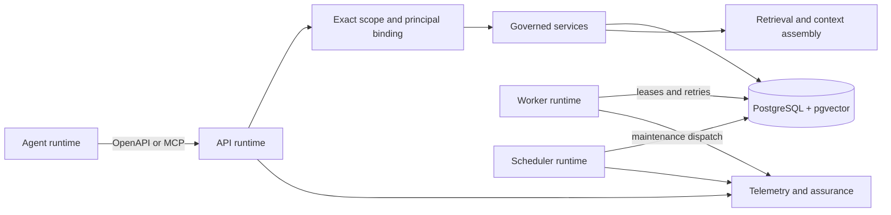
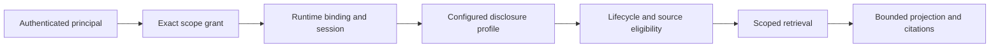
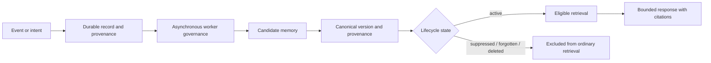

# Stele architecture

**Role:** overview. This page explains system boundaries and data flow;
[components](components.md), [self-hosting](self-hosting.md), the
[Provider contract](agent-runtime-memory-provider.md), and the
[OpenAPI source](../openapi/spec.go) remain the detailed authorities for their
subjects.

Stele is a self-hosted agent memory service. It stores durable memory and
evidence in PostgreSQL, uses pgvector and PostgreSQL full-text search for
retrieval, and exposes governed OpenAPI and optional MCP adapters to an
external agent runtime.

## System shape

The API, worker, and scheduler are separate runtime modes over the same
PostgreSQL system of record. They may be deployed as separate processes or
containers. The service does not execute an agent, call a model, maintain a
client-owned memory database, or make a second persistence system authoritative.

## Runtime modes

| Mode | Owns | Typical responsibilities |
| --- | --- | --- |
| `api` | Synchronous request boundary | Authentication, exact scope resolution, ingest, retrieval, context assembly, provider routes, optional MCP, health/readiness, and admin APIs |
| `worker` | Durable asynchronous processing | Governance, consolidation, derived work, leases, retries, lifecycle transitions, and projection maintenance |
| `scheduler` | Time-based dispatch | Retention, compaction, embedding rebuilds, cleanup, assurance, and maintenance job dispatch |

Workers and schedulers do not bypass the same scope, lifecycle, provenance, and
append-only rules used by API requests.

## Authorization and disclosure flow

Protected requests are resolved in order. The authenticated principal must
have an active grant for the exact tenant/project/namespace scope; public
Provider reads also require a server-issued runtime binding and a disclosure
profile configured for that scope. Lifecycle and source eligibility are
applied before retrieval results are projected into bounded citations or
context. Caller-supplied fields cannot widen scope, override a business role,
select a more permissive profile, or open another memory path.

Provider denial is final for that request. It does not authorize switching to
administrator MCP, native read APIs, another credential, local memory,
independent ranking, or reconstructed context.

## Event-to-memory lifecycle

Writes first create durable service-owned event or intent records. Worker
processing is asynchronous: it validates governance rules, produces candidates,
and may append a new canonical version with provenance. Canonical memory is
never overwritten in place. Retrieval reads eligible current projections;
suppressed, forgotten, or deleted records do not re-enter ordinary results
through broader search.

Each transition preserves scope and lineage so citations can be traced to
service-governed evidence without disclosing hidden candidates or internal
ranking state.

The admin assurance surface can inspect one opaque event fixture through four
distinct observations: durable admission, governance completion, active
canonical promotion, and a successful authorized Provider retrieval. The final
stage is recorded only after disclosure projection and response-size checks;
write acceptance or promotion alone never implies public retrievability. Reports
are deterministic, exact-scope, hash/category-only evidence and do not change
memory, lifecycle, disclosure, or task state.

## Choosing an integration boundary

| Need | Boundary | Ownership |
| --- | --- | --- |
| Public agent runtime needs governed context or memory writes | Provider | Versioned capabilities, exact binding, disclosure, bounded result |
| Administrator needs review and lifecycle tools | MCP | Optional adapter using administrator authorization |
| Custom service needs a specific HTTP operation | Native OpenAPI | Endpoint-level contract; caller retains integration logic |
| Change Stele internals | Go packages | Maintainer-only package APIs and repository tests |

Use the [Provider guide](agent-runtime-memory-provider.md) for public runtimes
and [MCP guide](integrations/mcp-agent-skill.md) for administrator workflows.
Provider denials do not permit fallback to another integration boundary.
Exact request and response behavior is defined by the OpenAPI and versioned
Provider contracts, not this overview.

## What Stele does not own

Stele does not execute model inference, own prompts, define product tasks or
business roles, commit application generations, or budget client-side model
tokens. The integrating application owns those responsibilities. Stele owns
memory persistence, governance, exact-scope authorization, retrieval, bounded
disclosure, provenance, lifecycle, and its own operational evidence.

## Request and memory flow

1. An authenticated principal establishes or presents an exact runtime binding.
2. The boundary resolves `tenant`, `project`, `namespace`, agent, session, and
   optional conversation identity. Caller input cannot widen the binding.
3. Read requests select lifecycle-visible projections and return bounded
   citations or context evidence.
4. Write requests append raw events or submit governed memory intents. They do
   not overwrite canonical memory directly.
5. Worker processing derives candidates and canonical versions asynchronously,
   preserving provenance, version history, and audit records.
6. Retrieval combines PostgreSQL full-text search, optional pgvector search,
   bounded fusion, lifecycle filtering, and exact-scope citations.
7. Maintenance and assurance jobs record bounded state and recovery evidence.

## Persistence boundaries

PostgreSQL is the only system of record. The principal persistence layers are:

- raw events and provenance records;
- candidate and canonical memory projections;
- append-only memory versions and lifecycle history;
- embeddings and retrieval projections;
- durable intent, job, lease, retention, and assurance records.

pgvector is an indexed retrieval capability, not a second source of truth.
PostgreSQL full-text search remains available for lexical-only deployments.

## Governance boundaries

Memory classes remain explicit: `profile`, `episodic`, `procedural`, `summary`,
and `relation`. Lifecycle remains explicit: `event -> candidate -> active`,
with `suppressed`, `forgotten`, and `deleted` outcomes. Canonical memory is
versioned and append-only from the service contract's perspective.

Default retrieval excludes suppressed and forgotten memory. Hidden records are
not restored merely because an agent asks for broader context. Administrative
inspection and lifecycle actions have separate authorization and audit rules.

## Extension points

- OpenAPI is the public contract boundary.
- MCP is an optional adapter over existing governed services.
- Provider synchronization uses transport-neutral cursor semantics; future
  WebSocket or SSE adapters must reuse the same contract.
- Retrieval channels and embedding providers are replaceable behind bounded
  interfaces.
- New memory behavior should enter through an OpenSpec change and preserve the
  PostgreSQL, scope, lifecycle, provenance, and audit constraints in `AGENTS.md`.

See [components](components.md), [best practices](best-practices.md),
[self-hosting](self-hosting.md), and the [provider contract](agent-runtime-memory-provider.md).

## Context disclosure and source trust

Provider final context uses `context-budget-v1` independent item-placement,
UTF-8 content-byte, unique canonical-citation and complete serialized-body
allocations. Retrieval owns whole-item admission inside its existing eligibility,
ordering, summary preference, deduplication and section policy. Provider supplies
costs from the same authorized mode-specific DTO used for emission, plus a
bounded conservative accounting reserve under `context-packing-v1`. The HTTP
route writes the finalized exact bytes including mandatory `budget_accounting`;
it performs no alternate ranking or suffix clipping. Paths, source metadata,
escaping and repeated citations consume body bytes; references consume zero
content bytes. Native/admin requests retain existing semantics.

Defaults are 100 items/100 citations, 1 MiB response bytes and content inherited
from the response ceiling; items/citations cap at 1000 and bytes at 4 MiB. Caller
limits independently intersect resolved server ceilings, with explicit content/
citation zero supported. Infeasible mandatory envelopes fail before retrieval
with 413 and no partial projection. Current disclosure denies use 403; unavailable
authority uses retryable 503 rather than an empty outcome. Closed safe accounting
does not reopen public insight/goal/projection/feedback/diagnostic paths or expose
hidden evidence. Token allocations remain unsupported.

Consumers negotiate versions and validate exact actual usage; strict schema and
independent item-ceiling migration is required. Disable consumers requiring PC3
before rollback to a binary without it, retaining durable data and PC2 grants.
See the [Provider guide](agent-runtime-memory-provider.md) and
[configuration guidance](self-hosting.md#provider-context-allocation-configuration)
for validation, units, errors, and rollout evidence.

PC5 durable references are a negotiated additive Provider capability. They reuse
the event, candidate, canonical version, and provenance lifecycle; they do not
introduce task or compilation business state.

PC6 records runtime-reported evidence in immutable projection identities and
source revisions (migration 0037). The exact-binding admission path only writes
evidence; a bounded asynchronous scheduler job maps eligible current PC5 lineage
to the existing usefulness log under `projection-feedback-v1`. Active feedback
queries recheck current authorization/lifecycle through a PostgreSQL view.
Corrections retain audit history and require existing ranking/insight gates.
See [projection maintenance](provider-evidence-projections.md).

Public runtime credentials require explicit exact-scope disclosure provisioning.
Provider context defaults to structured references; bounded content requires the
content profile and explicit mode. Unsupported native/MCP data routes deny public
credentials before lookup. Source labels persist through governance and history;
missing lineage is untrusted/restricted. Attested source data grants no instruction,
tool, write or business-state authority. See the [disclosure/source guide](context-disclosure-and-source-trust.md)
for endpoint behavior, administration, versioning and upgrade/rollback.

Provider context assembly remains Stele-owned: it applies current exact-scope
authority, source/lifecycle eligibility, retrieval ranking, deterministic
whole-item packing, citations and disclosure before emitting one complete body.
Each successful body carries a canonical projection digest and a continuity
result. A continuity receipt is a bounded PostgreSQL metadata record keyed by
the full runtime identity and an originating-read fingerprint; it stores no
query, selected memory IDs, content, citations or body. A later comparison is
always a newly assembled authorized body, never a historical snapshot or cache
response. Agent applications retain business authorization, tool use, write
policy, task state and compilation commit authority; digest equality does not
transfer any of those responsibilities.
