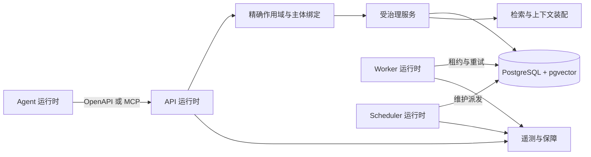
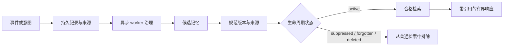

# Stele 架构

**角色：** 概览。本页说明系统边界与数据流；[关键组件](components.md)、
[自托管](self-hosting.md)、[Provider 契约](agent-runtime-memory-provider.md) 与
[OpenAPI 源](../openapi/spec.go) 仍是各自主题的详细权威。

Stele 是自托管的 agent 记忆服务。它把持久记忆与证据存储在 PostgreSQL 中，使用 pgvector
与 PostgreSQL 全文检索完成检索，并面向外部 agent 运行时暴露受治理的 OpenAPI 与可选 MCP
适配器。

## 系统形态

API、worker 与 scheduler 是构建在同一 PostgreSQL 记录系统之上的独立运行时模式。它们可以
作为独立进程或容器部署。该服务不执行 agent、不调用模型、不维护客户端自有的记忆数据库，
也不让第二套持久化系统取得权威地位。

## 运行时模式

| 模式 | 负责 | 典型职责 |
| --- | --- | --- |
| `api` | 同步请求边界 | 认证、精确作用域解析、摄取、检索、上下文装配、Provider 路由、可选 MCP、健康/就绪检查与管理员 API |
| `worker` | 持久异步处理 | 治理、整合、派生工作、租约、重试、生命周期流转与投影维护 |
| `scheduler` | 基于时间的派发 | 保留策略、压缩、嵌入重建、清理、保障与维护作业派发 |

Worker 与 scheduler 不会绕过 API 请求所用的作用域、生命周期、来源与仅追加规则。

## 授权与披露流程

受保护请求按顺序解析。已认证主体必须对精确的 tenant/project/namespace 作用域拥有活跃授权；
公共 Provider 读取还需要服务端签发的运行时绑定，以及为该作用域配置的披露 profile。生命周期
与来源资格先被应用，然后检索结果才被投影为有界引用或上下文。调用方提供的字段不能扩大
作用域、覆盖业务角色、选择更宽松的 profile，或开启另一条记忆路径。

Provider 拒绝对该请求是最终结果。它不授权改用管理员 MCP、原生读取 API、其他凭据、本地记忆、
独立排序或重建的上下文。

## 事件到记忆的生命周期

写入首先创建服务自有的持久事件或意图记录。Worker 处理是异步的：它校验治理规则、生成候选，
并可能追加带有来源信息的新规范版本。规范记忆永远不会被就地覆盖。检索读取合格的当前投影；
被抑制、已遗忘或已删除的记录不会通过更宽泛的检索重新进入普通结果。

每次流转都保留作用域与谱系，因此引用可以追溯到服务治理的证据，而不会披露隐藏候选或内部
排序状态。

管理员保障界面可以通过四种不同观测检查同一个不透明事件 fixture：持久准入、治理完成、
活跃规范提升，以及一次成功的已授权 Provider 检索。最后阶段只在披露投影与响应大小检查之后
记录；仅凭写入接受或提升永远不意味着公共可检索。报告是确定性的、精确作用域的、仅含哈希/
类别的证据，不改变记忆、生命周期、披露或任务状态。

## 选择集成边界

| 需求 | 边界 | 归属 |
| --- | --- | --- |
| 公共 agent 运行时需要受治理上下文或记忆写入 | Provider | 版本化能力、精确绑定、披露、有界结果 |
| 管理员需要审阅与生命周期工具 | MCP | 使用管理员授权的可选适配器 |
| 自定义服务需要特定 HTTP 操作 | 原生 OpenAPI | 端点级契约；调用方保留集成逻辑 |
| 修改 Stele 内部实现 | Go 包 | 仅维护者可用的包 API 与仓储测试 |

公共运行时使用 [Provider 指南](agent-runtime-memory-provider.md)，管理员工作流使用
[MCP 指南](integrations/mcp-agent-skill.md)。Provider 拒绝不允许回退到其他集成边界。
精确的请求与响应行为由 OpenAPI 与版本化 Provider 契约定义，而不是本概览。

## Stele 不拥有的职责

Stele 不执行模型推理、不拥有 prompt、不定义产品任务或业务角色、不提交应用生成结果，也不为
客户端侧模型 token 做预算。这些职责归集成应用所有。Stele 拥有记忆持久化、治理、精确作用域
授权、检索、有界披露、来源、生命周期以及自身的运维证据。

## 请求与记忆流程

1. 已认证主体建立或出示精确的运行时绑定。
2. 边界解析 `tenant`、`project`、`namespace`、agent、session 以及可选的对话身份。调用方
   输入不能扩大绑定。
3. 读请求选择生命周期可见的投影，并返回有界引用或上下文证据。
4. 写请求追加原始事件或提交受治理记忆意图。它们不会直接覆盖规范记忆。
5. Worker 处理异步派生候选与规范版本，保留来源、版本历史与审计记录。
6. 检索组合 PostgreSQL 全文检索、可选的 pgvector 检索、有界融合、生命周期过滤与精确
   作用域引用。
7. 维护与保障作业记录有界状态与恢复证据。

## 持久化边界

PostgreSQL 是唯一的记录系统。主要持久化层包括：

- 原始事件与来源记录；
- 候选与规范记忆投影；
- 仅追加的记忆版本与生命周期历史；
- 嵌入与检索投影；
- 持久意图、作业、租约、保留策略与保障记录。

受治理记忆意图使用专用 PostgreSQL schema 中的 Riverqueue 完成持久调度与重试。意图台账保持
权威，River 负载只包含意图 ID。意图准入与作业插入共享一个事务；worker 治理效果、意图历史
与 River 作业完成共享另一个事务。在这一有界切换期间，其他派生工作种类仍留在既有队列上。

pgvector 是带索引的检索能力，不是第二个事实来源。仅词法部署仍可使用 PostgreSQL 全文检索。

### 派生表示评估

精确摘录、主题投影与父级优先/层级证据可以作为派生检索表示进行比较。该比较被约束在精确
作用域、来源水位、生命周期可见的源记录、相等预算以及仓库自有的校验和锁定 fixture 之内。
它始终保留已授权的源检索通道；没有任何投影、图、wiki 或文档存储取得权威地位。评估器只输出
有界聚合证据，并将其持久化为仅追加的 PostgreSQL 派生报告，带保留清理。

该评估是离线或仅影子的。`flat-fusion-v1` 仍是普通检索与上下文装配的选用策略，HTTP、
Provider 与 MCP 界面不暴露选择器或报告路由。未来的发布评审可以把新的兼容聚合证据作为一项
前提条件，但这不授权激活，也不使观测到的任务差异成为因果关系。

常驻上下文评估复用 `always_visible` profile 物化器与既有的 PostgreSQL 源/投影存储。它把
置信度/大小放置策略与一种候选条件比较：该条件要求可归属的、版本/内容绑定的支持，外加后续
留出的效用。流行度没有选择权。两种条件都强制相同的独立条目/内容字节/空白 token/引用上限。
方案保持为内部评估器私有；脱敏报告绑定实际来源与输出哈希，而外部观测结果保持独立。不引入
报告表、新存储、迁移、在线策略 worker、公共选择器或默认值变更。证据边界与基线回滚见
[上下文投影](context-projections.md#evidence-gated-resident-context-evaluation)。

## 治理边界

记忆类别保持显式：`profile`、`episodic`、`procedural`、`summary` 与 `relation`。生命周期
保持显式：`event -> candidate -> active`，以及 `suppressed`、`forgotten` 与 `deleted` 结果。
从服务契约的视角看，规范记忆是版本化的且仅追加。

默认检索排除被抑制与已遗忘的记忆。隐藏记录不会仅因为 agent 请求更宽泛的上下文而恢复。
管理性检查与生命周期操作有独立的授权与审计规则。

## 扩展点

- OpenAPI 是公共契约边界。
- MCP 是既有受治理服务之上的可选适配器。
- Provider 同步使用与传输无关的游标语义；未来的 WebSocket 或 SSE 适配器必须复用同一契约。
- 检索通道与嵌入 Provider 可在有界接口之后替换。
- 新的记忆行为应通过 OpenSpec 变更引入，并保留 `AGENTS.md` 中的 PostgreSQL、作用域、
  生命周期、来源与审计约束。

参见[关键组件](components.md)、[最佳实践](best-practices.md)、[自托管](self-hosting.md) 与
[Provider 契约](agent-runtime-memory-provider.md)。

## 上下文披露与来源信任

Provider 最终上下文使用 `context-budget-v1` 的独立条目放置、UTF-8 内容字节、唯一规范引用与
完整序列化正文分配。检索在既有的资格、排序、摘要偏好、去重与分段策略内负责整条目准入。
Provider 根据与输出相同的已授权模式相关 DTO 提供成本，并在 `context-packing-v1` 下提供有界
的保守计费预留。HTTP 路由写出最终确定的精确字节（包括强制的 `budget_accounting`）；它不执行
替代排序或后缀裁剪。路径、来源元数据、转义与重复引用都会消耗正文字节；引用消耗零内容字节。
原生/管理员请求保留既有语义。

默认值为 100 条目/100 引用、1 MiB 响应字节以及从响应上限继承的内容限制；条目/引用上限为
1000，字节上限为 4 MiB。调用方限制与解析后的服务端上限独立相交，并支持显式的零内容/零引用。
不可行的强制信封会在检索之前以 413 失败，且不产生部分投影。当前披露拒绝使用 403；不可用的
授权使用可重试的 503，而不是空结果。封闭的安全计费不会重新开放公共洞察/目标/投影/反馈/
诊断路径，也不会暴露隐藏证据。token 分配仍不受支持。

消费方需协商版本并校验精确的实际用量；必须迁移严格 schema 与独立的条目上限。回滚到不支持
PC3 的二进制之前，先禁用依赖 PC3 的消费方，并保留持久数据与 PC2 授权。校验、单位、错误与
发布证据见 [Provider 指南](agent-runtime-memory-provider.md) 与
[配置指导](self-hosting.md#provider-context-allocation-configuration)。

PC5 持久引用是协商式增量 Provider 能力。它们复用 event、candidate、规范版本与来源生命周期；
不引入任务或编译业务状态。

PC6 以不可变投影身份与源修订记录运行时上报的证据（迁移 0037）。精确绑定准入路径只写入证据；
一个有界的异步 scheduler 作业把合格的当前 PC5 谱系映射到 `projection-feedback-v1` 下既有的
有用性日志。活跃反馈查询通过 PostgreSQL 视图重新校验当前授权/生命周期。更正保留审计历史，
并需要既有的排序/洞察门禁。参见[投影维护](provider-evidence-projections.md)。

公共运行时凭据需要显式的精确作用域披露配置。Provider 上下文默认返回结构化引用；有界内容需要
content profile 与显式模式。不受支持的 native/MCP 数据路由会在查询前拒绝公共凭据。来源标签
贯穿治理与历史持久保存；缺失谱系的数据视为不可信/受限。已证实的来源数据不授予任何指令、工具、
写入或业务状态权限。端点行为、管理、版本化以及升级/回滚见
[披露/来源指南](context-disclosure-and-source-trust.md)。

Provider 上下文装配仍由 Stele 拥有：它应用当前精确作用域授权、来源/生命周期资格、检索排序、
确定性的整条目打包、引用与披露，然后输出一个完整正文。每个成功正文都携带规范投影摘要与连续性
结果。连续性回执是一条有界的 PostgreSQL 元数据记录，以完整运行时身份与发起读取的指纹为键；
它不存储查询、被选中的记忆 ID、内容、引用或正文。后续比较始终是新装配的已授权正文，绝不是
历史快照或缓存响应。agent 应用保留业务授权、工具使用、写入策略、任务状态与编译提交权限；
摘要相等不会转移其中任何职责。

## 程序性验证与受治理更正

管理员可以为精确 tenant、project 与 namespace 作用域下某个当前活跃的 `procedural` 记忆版本
追加一条**仅追加的验证台账**记录。该记录保留有界的来源/版本引用、处置、策略与审计元数据。
它不是记忆类别、生命周期流转，也不是直接变更授权的来源。

来源漂移与显式复查请求会创建有界的 `procedural_revalidation` 工作。Worker 只重新解析已记录的
证据；它可以追加 `inconclusive` 或 `needs_revalidation`，但永远不会推断支持、撰写更正，或把
模型当作验证权威。带有更正内容的被否定记录可以提交受治理更新意图，并携带不可变的验证归属。
治理 worker 在创建候选或后继之前会重新检查所有资格，并且**不会覆盖规范记忆**。

这条 API/worker/scheduler 路径保持特权：公共 Provider、普通检索与 MCP 公共运行时界面既不发现
也不返回这些记录。PostgreSQL 仍是唯一记录系统；禁用该特性会停止新的准入与派发，同时保留台账、
意图与规范历史以供审计。
